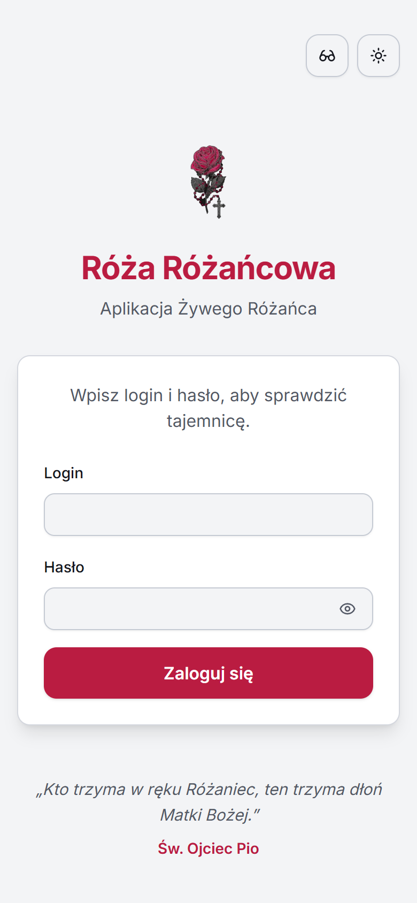
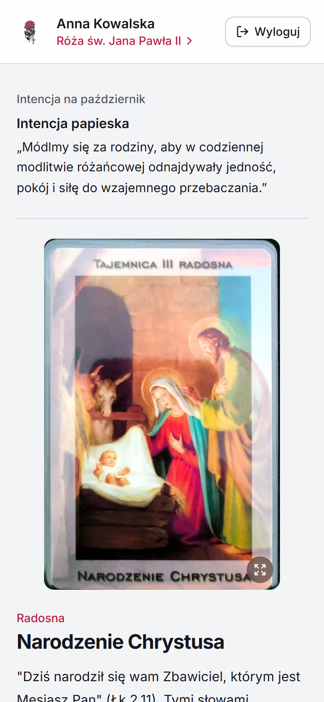
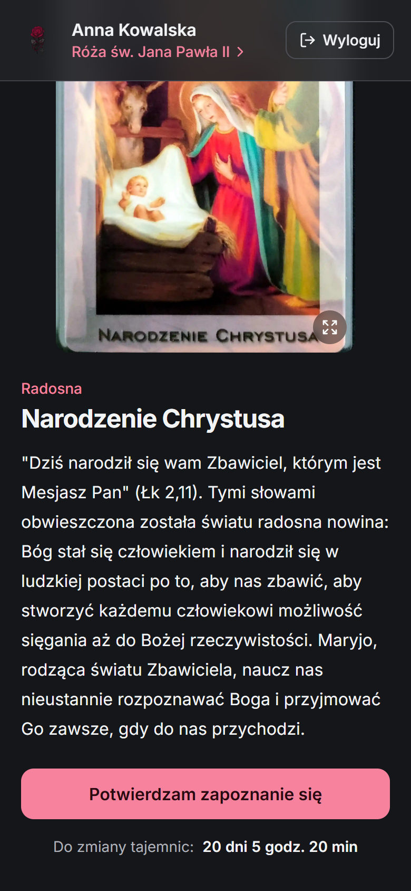
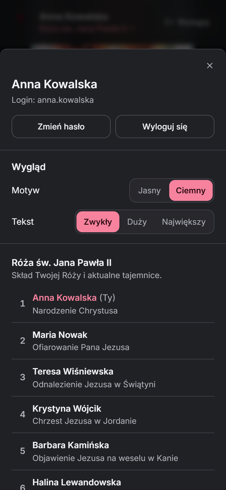
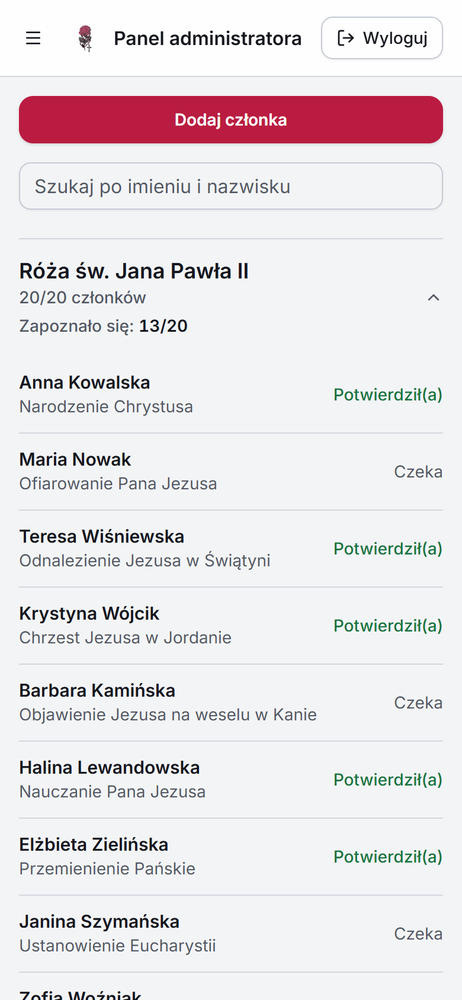
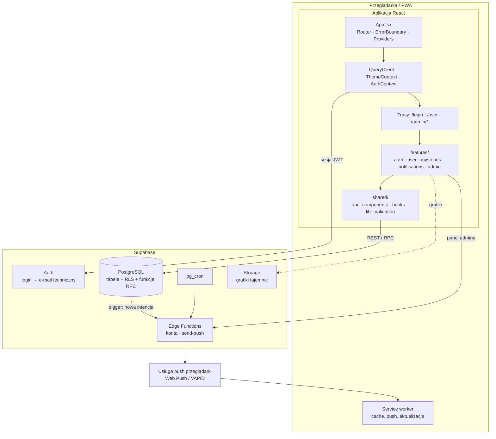
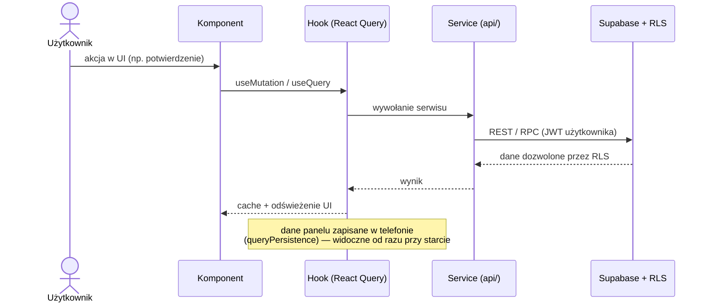
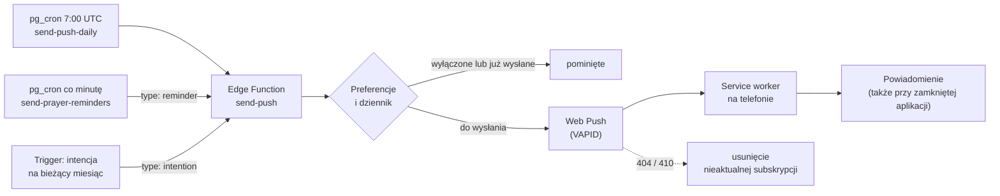
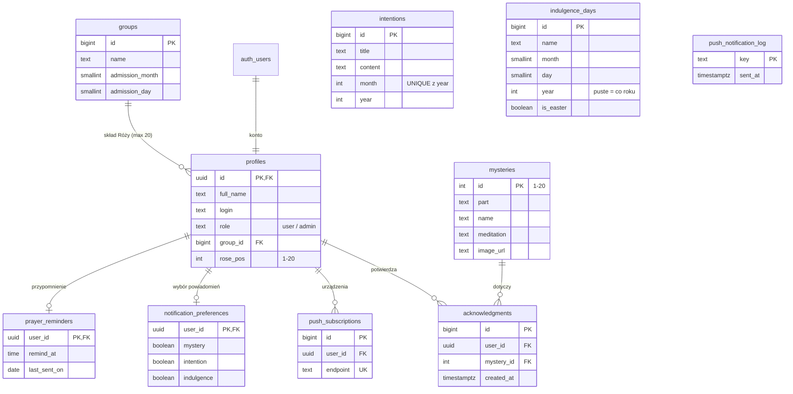

<div align="center">


# Róża Różańcowa

**Aplikacja webowa do zarządzania grupami Żywego Różańca**

Ułatwia organizację modlitwy, automatyczną rotację tajemnic różańcowych oraz komunikację wewnątrz wspólnoty.

[](https://react.dev/)
[](https://www.typescriptlang.org/)
[](https://supabase.com/)
[](https://vitejs.dev/)
[](LICENSE)

[Aplikacja](https://roza-pd.vercel.app) • [Instalacja](#-instalacja-i-uruchomienie) • [Dokumentacja](#-architektura-aplikacji) • [Kontakt](#-kontakt)

</div>

---

## 📑 Spis treści

- [Opis projektu](#-opis-projektu)
- [Zrzuty ekranu](#-zrzuty-ekranu)
- [Stack technologiczny](#%EF%B8%8F-stack-technologiczny)
- [Architektura aplikacji](#-architektura-aplikacji)
- [Struktura katalogów](#-struktura-katalogów)
- [Wymagania systemowe](#-wymagania-systemowe)
- [Instalacja i uruchomienie](#-instalacja-i-uruchomienie)
- [Konfiguracja środowiska](#-konfiguracja-środowiska)
- [Baza danych](#%EF%B8%8F-baza-danych)
- [Testy](#-testy)
- [Linting i formatowanie](#-linting-i-formatowanie)
- [Standardy kodu](#-standardy-kodu)
- [Deployment](#-deployment)
- [Roadmapa](#-roadmapa)
- [FAQ / Najczęstsze problemy](#-faq--najczęstsze-problemy)
- [Licencja](#-licencja)
- [Kontakt](#-kontakt)

---

## 📖 Opis projektu

### Kontekst

**Żywy Różaniec** to wspólnota modlitewna, w której 20 osób (tzw. Róża) codziennie odmawia po jednej tajemnicy różańcowej. Co miesiąc tajemnice rotują między członkami, co wymaga koordynacji i komunikacji.

Aplikacja **Róża Różańcowa** digitalizuje ten proces, eliminując potrzebę ręcznego zarządzania listami i rotacjami.

### Główne funkcjonalności

#### 👤 Panel Użytkownika

- **Podgląd tajemnicy** — tajemnica przypisana na bieżący okres, z rozważaniem i grafiką (podgląd grafiki na pełnym ekranie)
- **Potwierdzenie modlitwy** — odznaczenie tajemnicy; status liczony tylko w bieżącym okresie
- **Licznik czasu** — odliczanie do najbliższej zmiany tajemnic (pierwsza niedziela miesiąca)
- **Widok Róży** — członkowie Róży z ich aktualnymi tajemnicami
- **Intencja miesięczna** — wspólna intencja modlitewna dla całej grupy
- **Dzień odpustu** — karta z warunkami uzyskania odpustu w dniu, w którym wypada
- **Panel konta** — wygląd (motyw jasny/ciemny, tryb seniora z większym tekstem i wysokim kontrastem), wybór powiadomień, zmiana własnego hasła
- **Powiadomienia push** — nowa tajemnica, nowa intencja, dni odpustu, dzień przyjęcia Róży i codzienne przypomnienie o modlitwie o wybranej godzinie (Web Push, działa przy zamkniętej aplikacji)
- **Szybkie uruchomienie** — dane panelu zapamiętane w telefonie, widoczne od razu, odświeżane w tle

#### 🛡️ Panel Administratora

- **Użytkownicy** — dodawanie, zmiana loginu i hasła, usuwanie, przypisywanie do Róż; status potwierdzenia tajemnicy przy każdej osobie
- **Róże** — tworzenie grup, dzień przyjęcia do Stowarzyszenia, skład Róży, ręczna rotacja tajemnic
- **Intencja** — intencja na miesiąc, edycja i historia
- **Odpusty** — kalendarz dni odpustu (daty stałe i Wielkanoc liczona automatycznie)

Tajemnice zmieniają się same — numer tajemnicy wynika z pozycji w Róży i daty (pierwsza niedziela miesiąca), bez zadań w tle. Ręczna rotacja służy tylko do korekty.

---

## 📱 Zrzuty ekranu

Aplikacja jest projektowana pod telefon (mobile-first). Zrzuty na danych przykładowych.

<table>
  <tr>
    <td align="center"></td>
    <td align="center"></td>
    <td align="center"></td>
  </tr>
  <tr>
    <td align="center"><sub>Logowanie</sub></td>
    <td align="center"><sub>Tajemnica i intencja</sub></td>
    <td align="center"><sub>Rozważanie, potwierdzenie, licznik</sub></td>
  </tr>
  <tr>
    <td align="center"></td>
    <td align="center"></td>
    <td></td>
  </tr>
  <tr>
    <td align="center"><sub>Panel konta i skład Róży</sub></td>
    <td align="center"><sub>Admin: członkowie i potwierdzenia</sub></td>
    <td></td>
  </tr>
</table>

Odświeżenie zrzutów po zmianach w wyglądzie: `node scripts/readme-screenshots.mjs`. Skrypt uruchamia aplikację
z fałszywym adresem Supabase i odpowiada na zapytania danymi przykładowymi — bez konta i bez zapytań do bazy.
Z sieci pobiera tylko publiczne grafiki tajemnic.

---

## 🛠️ Stack technologiczny

| Kategoria | Technologie |
|-----------|-------------|
| **Frontend** | React 19, TypeScript 5.9, Vite 7.x |
| **Styling** | Tailwind CSS 3.4, shadcn/ui (Radix UI), Lucide Icons |
| **State Management** | TanStack Query 5.x (React Query), React Context |
| **Formularze** | React Hook Form 7.x, Zod 4.x (`zod/mini`) |
| **Routing** | React Router 7.x (lazy loading stron i dialogów) |
| **Backend** | Supabase (PostgreSQL 17, Auth, Edge Functions, Storage, pg_cron, Vault) |
| **PWA** | vite-plugin-pwa (Workbox), offline support, instalacja na urządzeniu, Web Push (VAPID) |
| **Testy** | Vitest 4.x, React Testing Library 16.x, Playwright 1.x |
| **Hosting** | Vercel (frontend), Supabase (backend) |
| **Narzędzia** | ESLint 9.x, TypeScript ESLint, PostCSS, Autoprefixer |

---

## 🏗 Architektura aplikacji

### Wzorzec: Feature-Based Architecture

Projekt wykorzystuje architekturę **Feature-Based** (modularną), gdzie kod jest organizowany wokół funkcjonalności biznesowych, a nie typów plików.



### Przepływ danych



### Odpowiedzialności warstw

| Warstwa | Odpowiedzialność |
|---------|------------------|
| `pages/` | Kompozycja komponentów, layout strony |
| `components/` | Prezentacja UI, obsługa eventów |
| `hooks/` | Logika biznesowa, state management |
| `api/` | Komunikacja z backendem (Supabase) |
| `types/` | Definicje TypeScript |

---

## 📁 Struktura katalogów

```
src/
├── app/                        # Konfiguracja aplikacji
│   ├── App.tsx                 # Główny komponent
│   ├── providers.tsx           # Providery (Query, Theme, Auth)
│   ├── routes.tsx              # Definicje tras (React Router, lazy)
│   ├── registerServiceWorker.ts  # Rejestracja SW, przeładowanie po nowym wdrożeniu
│   └── reloadOnStaleChunk.ts   # Przeładowanie, gdy brakuje pliku starej wersji
│
├── features/                   # Moduły funkcjonalne
│   ├── auth/                   # Logowanie (login → e-mail techniczny), AuthContext, ProtectedRoute
│   ├── user/                   # Panel użytkownika
│   │   ├── api/                # user.service.ts, user.queries.ts
│   │   ├── components/         # MysteryCard, IntentionCard, IndulgenceCard, RoseDialog (panel konta),
│   │   │                       # MysteryChangeCountdown, ChangePasswordDialog
│   │   ├── hooks/              # useUserData.ts, useMysteryChangeTimer.ts
│   │   └── pages/              # UserPage.tsx
│   ├── mysteries/              # Tajemnica użytkownika, potwierdzenie modlitwy
│   ├── notifications/          # Subskrypcja push, wybór powiadomień, przypomnienie o modlitwie
│   └── admin/                  # Panel administratora
│       ├── layout/             # AdminLayout.tsx (menu boczne, ustawienia wyglądu)
│       ├── members/            # Użytkownicy
│       ├── roses/              # Róże
│       ├── intentions/         # Intencje
│       └── indulgences/        # Dni odpustu
│
├── shared/                     # Współdzielone zasoby
│   ├── api/                    # groups.service.ts, membersOverview.service.ts
│   ├── components/
│   │   ├── ui/                 # shadcn/ui (Button, Dialog, Sheet, Select...)
│   │   ├── common/             # Tryb seniora, motyw, podgląd grafiki, ResizableText...
│   │   ├── feedback/           # Splash, loadery, dialogi potwierdzenia
│   │   └── layout/             # ErrorBoundary, FeatureErrorBoundary
│   ├── context/                # ThemeContext (motyw, tryb seniora)
│   ├── hooks/                  # useTypedMutation.ts, useStatusBarColor.ts
│   ├── lib/                    # supabase client, queryClient, queryPersistence, liturgical (Wielkanoc), constants
│   ├── types/                  # Globalne typy (domain, database)
│   └── validation/             # Schematy Zod
│
└── assets/                     # Statyczne zasoby (fonty)

supabase/
├── config.toml                 # Konfiguracja lokalna Supabase
├── seed.sql                    # Dane inicjalne (20 tajemnic)
├── full_schema_dump.sql        # Zrzut schematu z 2026-09 (nieaktualny — aktualny stan w migrations/)
├── migrations/                 # Migracje schematu DB
└── functions/                  # Edge Functions (Deno)
    ├── _shared/                # auth.ts (requireAdmin), cors.ts
    ├── create-user/
    ├── delete-user/
    ├── update-user-login/
    ├── update-user-password/
    └── send-push/              # Wysyłka powiadomień (pg_cron)

scripts/
└── generate-splash-screens.mjs # Ekrany startowe PWA (iOS)
```

---

## 💻 Wymagania systemowe

| Narzędzie | Wersja minimalna | Uwagi |
|-----------|------------------|-------|
| **Node.js** | 20.19 | Lub 22.12+ (wymóg Vite 7) |
| **npm** | 10.x | Lub yarn/pnpm |
| **Docker** | 20.x | Opcjonalnie, do testów migracji na lokalnym Postgresie |
| **Git** | 2.x | |
| **OS** | Windows/macOS/Linux | |

---

## 🚀 Instalacja i uruchomienie

### Szybki start (< 10 minut)

```bash
# 1. Sklonuj repozytorium
git clone https://github.com/pponikiewski/roza-rozancowa.git
cd roza-rozancowa

# 2. Zainstaluj zależności
npm install

# 3. Utwórz plik .env.local i uzupełnij zmienne środowiskowe (patrz sekcja Konfiguracja)
#    VITE_SUPABASE_URL=https://your-project.supabase.co
#    VITE_SUPABASE_PUBLISHABLE_DEFAULT_KEY=eyJ...

# 4. Uruchom serwer deweloperski
npm run dev
```

Aplikacja będzie dostępna pod adresem: `http://localhost:5173`

### Lokalna baza Supabase

`npx supabase start` nie stawia bazy z tego repo. Migracja `20260905004027_remote_schema.sql` tworzy triggery
na tabelach `storage.*` z funkcją `storage.protect_delete()`, której nie ma w lokalnym obrazie. Do pracy nad
aplikacją wystarcza projekt w chmurze.

Migracje testuje się na samym obrazie Postgres (`public.ecr.aws/supabase/postgres`): atrapa
`storage.protect_delete()`, migracje po kolei przez `psql`, a przy zmianach RLS — porównanie uprawnień
(anon / użytkownik / admin) przed i po migracji.

### Dostępne skrypty

| Polecenie | Opis |
|-----------|------|
| `npm run dev` | Uruchomienie serwera deweloperskiego (Vite) |
| `npm run build` | Budowanie wersji produkcyjnej |
| `npm run preview` | Podgląd wersji produkcyjnej lokalnie |
| `npm run lint` | Sprawdzenie kodu (ESLint) |
| `npm run test` | Uruchomienie testów jednostkowych (Vitest) |
| `npm run test:ui` | Testy z interfejsem graficznym |
| `npm run test:coverage` | Generowanie raportu pokrycia kodu |
| `npm run test:integration` | Uruchomienie testów integracyjnych (Vitest) |
| `npm run test:e2e` | Uruchomienie testów e2e (Playwright) |
| `npm run test:e2e:ui` | Testy e2e z interfejsem graficznym |
| `npm run test:e2e:debug` | Testy e2e w trybie debugowania |

---

## ⚙ Konfiguracja środowiska

### Zmienne środowiskowe

Utwórz plik `.env.local` w głównym katalogu projektu (Vite czyta też `.env`):

```env
# Supabase - WYMAGANE
VITE_SUPABASE_URL=https://your-project.supabase.co
VITE_SUPABASE_PUBLISHABLE_DEFAULT_KEY=eyJhbGciOiJIUzI1NiIsInR5cCI6IkpXVCJ9...

# Powiadomienia push - klucz publiczny VAPID (opcjonalne; bez niego karta powiadomień jest ukryta)
VITE_VAPID_PUBLIC_KEY=BNc...

# Tylko dla testów E2E (opcjonalne)
VITE_SUPABASE_SERVICE_ROLE_KEY=...
```

> ⚠️ **Uwaga:** Nigdy nie commituj plików `.env*` z prawdziwymi kluczami!

### Powiadomienia push

Wysyłkę obsługuje Edge Function `send-push`, uruchamiana przez `pg_cron` codziennie o 7:00 UTC. Typy powiadomień:

| Powiadomienie | Kiedy |
|---|---|
| Nowa tajemnica (każdy dostaje swoją) | pierwsza niedziela miesiąca |
| Nowa intencja | od razu po zapisaniu intencji na bieżący miesiąc (trigger) |
| Dzień odpustu | w dniu z tabeli `indulgence_days` (panel admina → Odpusty); Wielkanoc liczona automatycznie |
| Dzień przyjęcia do Stowarzyszenia | co roku w dniu ustawionym dla Róży (panel admina → Róże), tylko dla jej członków |
| Przypomnienie o modlitwie | codziennie o godzinie wybranej przez użytkownika (panel konta → Powiadomienia); osobne zadanie `pg_cron` co minutę |

Użytkownik wybiera w panelu konta, które powiadomienia chce dostawać (tabela `notification_preferences`; brak wiersza = wszystkie włączone). Każde powiadomienie wychodzi tylko raz — klucz zapisywany jest w `push_notification_log` (przypomnienia: kolumna `prayer_reminders.last_sent_on`).



Konfiguracja (jednorazowo):

```bash
# 1. Wygeneruj klucze VAPID
npx web-push generate-vapid-keys

# 2. Sekrety Edge Function (CRON_SECRET — dowolny losowy ciąg)
npx supabase secrets set VAPID_PUBLIC_KEY=... VAPID_PRIVATE_KEY=... \
  VAPID_SUBJECT=mailto:admin@example.com CRON_SECRET=...

# 3. Wdrożenie migracji i funkcji
npx supabase db push
npx supabase functions deploy send-push
```

```sql
-- 4. Sekrety w Vault (SQL Editor) — używane przez zadanie pg_cron
select vault.create_secret('https://<project-ref>.supabase.co', 'project_url');
select vault.create_secret('<ta sama wartość co CRON_SECRET>', 'push_cron_secret');
```

Na koniec (krok 5) dodaj `VITE_VAPID_PUBLIC_KEY` (klucz publiczny z kroku 1) do `.env.local` i zmiennych środowiskowych na Vercelu.

Test ręczny wysyłki — `type`: `mystery` / `intention` / `indulgence` / `reminder`; `force: true` pomija datę i dziennik (dla `reminder` — wysyła do wszystkich z włączonym przypomnieniem):

```bash
curl -X POST https://<project-ref>.supabase.co/functions/v1/send-push \
  -H "x-cron-secret: <CRON_SECRET>" -H "Content-Type: application/json" \
  -d '{"type": "mystery", "force": true}'
```

> 📱 Na iPhonie (iOS 16.4+) powiadomienia działają tylko po dodaniu aplikacji do ekranu początkowego. Karta na pulpicie pokazuje wtedy instrukcję.

---

## 🗄️ Baza danych

### Schemat tabel



`auth_users` to tabela `auth.users` (Supabase Auth). `intentions`, `indulgence_days` i `push_notification_log`
nie mają kluczy obcych — intencja i odpusty są wspólne dla wszystkich Róż.

Powiadomienia i odpusty:

| Tabela | Zawartość |
|--------|-----------|
| `push_subscriptions` | Subskrypcje Web Push (jeden endpoint = jedno urządzenie) |
| `notification_preferences` | Wybrane typy powiadomień (brak wiersza = wszystkie włączone) |
| `prayer_reminders` | Godzina codziennego przypomnienia (Europe/Warsaw), `last_sent_on` |
| `push_notification_log` | Klucze wysłanych powiadomień — ochrona przed duplikatami |
| `indulgence_days` | Dni odpustu: data stała (`month`, `day`, opcjonalnie `year`) albo `is_easter` |

### Kluczowe funkcje SQL

| Funkcja | Opis |
|---------|------|
| `get_mystery_id_for_user(user_id)` | Aktualna tajemnica z pozycji w Róży i daty (zmiana w pierwszą niedzielę miesiąca, modulo 20) |
| `get_mystery_ids_for_users(user_ids[])` | To samo dla wielu osób naraz (m.in. `send-push`) |
| `current_mystery_period_start()` | Początek bieżącego okresu tajemnic |
| `get_members_overview(group_id)` | Członkowie z tajemnicą i statusem potwierdzenia w jednym zapytaniu |
| `acknowledge_mystery()` / `is_mystery_acknowledged()` | Zapis i odczyt potwierdzenia w bieżącym okresie (czas serwera) |
| `rotate_group_members(group_id)` | Ręczna rotacja Róży o jedną pozycję (tylko admin) |
| `move_user_to_group(user_id, group_id)` | Przypisanie do pierwszego wolnego miejsca w Róży (tylko admin) |
| `generate_login(full_name)` | Unikalny login z imienia i nazwiska (trigger przy tworzeniu konta) |
| `save_push_subscription(...)` | Zapis subskrypcji push bieżącego użytkownika |
| `claim_due_prayer_reminders()` | Rezerwacja przypomnień, których pora minęła |

### Zadania pg_cron

| Zadanie | Harmonogram (UTC) | Działanie |
|---------|-------------------|-----------|
| `send-push-daily` | `0 7 * * *` | `send-push`: tajemnica, odpust, dzień przyjęcia Róży |
| `send-prayer-reminders` | `* * * * *` | `send-push` z `type: reminder` |
| `cleanup-cron-history` | `30 3 * * *` | Usuwa historię uruchomień `cron.job_run_details` starszą niż 7 dni |

### Row Level Security (RLS)

- **Anonim**: brak dostępu do danych (profile, Róże, intencje i odpusty tylko po zalogowaniu)
- **Użytkownik**: odczyt profili (bez kolumny `profiles.email`), Róż, intencji i dni odpustu; własne potwierdzenia, subskrypcje, przypomnienie i ustawienia powiadomień; zapis potwierdzenia tylko przez `acknowledge_mystery()`; bez edycji własnego profilu
- **Administrator**: zapis intencji, profili, Róż i dni odpustu, wgląd we wszystkie potwierdzenia; funkcje admina sprawdzają rolę (`is_admin()`)
- **Edge Functions**: konta tworzone i zmieniane przez `service_role` po sprawdzeniu roli admina (`_shared/auth.ts`)

### Migracje i Seed

```bash
# Push na produkcję (po teście migracji na lokalnym Postgresie — patrz Instalacja)
npx supabase db push

# Zrzut schematu do porównania przed i po migracji
npx supabase db dump --schema public
```

Plik `supabase/seed.sql` zawiera 20 tajemnic różańcowych z opisami i grafikami.

---

## 🧪 Testy

Projekt zawiera testy jednostkowe i integracyjne (Vitest + React Testing Library) oraz end-to-end (Playwright).

### Struktura testów

```
tests/
├── unit/                   # Testy jednostkowe
│   ├── auth/               # LoginPage, ProtectedRoute
│   ├── user/               # MysteryCard, IndulgenceCard, useMysteryChangeTimer
│   ├── admin/              # members.service
│   ├── notifications/      # push.service
│   └── shared/             # liturgical (Wielkanoc), queryPersistence
├── integration/            # Pełne ekrany z zamockowanym Supabase
│   ├── admin/              # AdminIntentionsIntegration
│   └── user/               # UserDashboardIntegration
├── e2e/                    # Testy end-to-end (Playwright, Chromium)
│   ├── auth/               # Logowanie
│   ├── fixtures/           # Dane testowe
│   ├── helpers/            # Funkcje pomocnicze
│   └── global-setup.ts     # Konta testowe (service role key)
├── utils/                  # Renderowanie z providerami, helpery hooków
└── setup.ts                # Konfiguracja środowiska testowego
```

Szczegóły: [tests/README.md](tests/README.md), [tests/e2e/README.md](tests/e2e/README.md).

### Polecenia testowe

```bash
# Testy jednostkowe (Vitest)
npm run test

# Testy integracyjne
npm run test:integration

# Testy z interfejsem UI
npm run test:ui

# Testy e2e (Playwright)
npm run test:e2e

# Testy e2e z UI
npm run test:e2e:ui

# Testy e2e w trybie debug
npm run test:e2e:debug

# Coverage
npm run test:coverage
```

---

## 🧹 Linting i formatowanie

### ESLint

Projekt używa ESLint 9.x z flat config:

```bash
# Sprawdzenie błędów
npm run lint

# Automatyczna naprawa
npm run lint -- --fix
```

### Konfiguracja (`eslint.config.js`)

- `@eslint/js` — bazowe reguły JavaScript
- `typescript-eslint` — wsparcie TypeScript
- `eslint-plugin-react-hooks` — reguły React Hooks
- `eslint-plugin-react-refresh` — wsparcie HMR

### Prettier (opcjonalnie)

Projekt nie wymusza Prettiera — formatowanie można dodać według preferencji zespołu.

---

## 📐 Standardy kodu

### Konwencje nazewnictwa

| Element | Konwencja | Przykład |
|---------|-----------|----------|
| Komponenty | PascalCase | `MysteryCard.tsx` |
| Hooki | camelCase + `use` prefix | `useUserData.ts` |
| Funkcje/zmienne | camelCase | `handleSubmit`, `isLoading` |
| Typy/Interfejsy | PascalCase | `Profile`, `Mystery` |
| Stałe | SCREAMING_SNAKE_CASE | `QUERY_KEYS`, `ROUTES` |
| Pliki CSS | kebab-case | `index.css` |

### Struktura komponentu

```tsx
// 1. Importy (external → internal → types)
import { useState } from 'react'
import { Button } from '@/shared/components/ui/button'
import type { Profile } from '@/shared/types/domain.types'

// 2. Typy (jeśli lokalne)
interface MemberCardProps {
  member: Profile
  onEdit?: () => void
}

// 3. Komponent
export function MemberCard({ member, onEdit }: MemberCardProps) {
  // Hooki
  const [isOpen, setIsOpen] = useState(false)
  
  // Handlery
  const handleClick = () => setIsOpen(true)
  
  // Render
  return (
    <div>...</div>
  )
}
```

### Konwencja commitów (Conventional Commits)

```
<type>(<scope>): <description>

[optional body]

[optional footer]
```

**Typy:**

- `feat` — nowa funkcjonalność
- `fix` — naprawa błędu
- `docs` — dokumentacja
- `style` — formatowanie (nie zmieniające logiki)
- `refactor` — refaktoryzacja
- `test` — testy
- `chore` — zadania pomocnicze

**Przykłady:**

```
feat(admin): add batch mystery rotation
fix(dashboard): correct countdown timer calculation
docs(readme): update installation instructions
```

---

## 🚢 Deployment

### Vercel (produkcja)

Projekt jest skonfigurowany do deploymentu na **Vercel**:

1. Połącz repozytorium z Vercel
2. Ustaw zmienne środowiskowe (`VITE_SUPABASE_URL`, `VITE_SUPABASE_PUBLISHABLE_DEFAULT_KEY`, `VITE_VAPID_PUBLIC_KEY`)
3. Push do `pd` buduje Preview; wersję na produkcję promuje się ręcznie w panelu Vercel

**Konfiguracja** (`vercel.json`): pliki z `/assets/` z cache na rok (nazwy z hashem), pozostałe adresy
kierowane do `index.html`. Rewrite pomija `/assets/` — brakujący plik starej wersji zwraca 404 zamiast
`index.html` (aplikacja przeładowuje się wtedy do nowej wersji, `src/app/reloadOnStaleChunk.ts`).

```json
{
  "headers": [{ "source": "/assets/(.*)", "headers": [{ "key": "Cache-Control", "value": "public, max-age=31536000, immutable" }] }],
  "rewrites": [{ "source": "/((?!assets/).*)", "destination": "/index.html" }]
}
```

### Środowiska

| Środowisko | Branch | URL |
|------------|--------|-----|
| Production | `pd` (promocja w Vercel) | `https://roza-pd.vercel.app` |
| Preview | każdy push | Automatyczne preview URL |
| Local | — | `http://localhost:5173` |

### Edge Functions (Supabase)

```bash
# Deploy funkcji
npx supabase functions deploy create-user
npx supabase functions deploy delete-user
npx supabase functions deploy update-user-login
npx supabase functions deploy update-user-password
npx supabase functions deploy send-push
```

### Aktualizacja aplikacji u użytkowników

Po wdrożeniu nowej wersji service worker przeładowuje otwarte okna, które działają jeszcze na starym kodzie
(`src/app/registerServiceWorker.ts`). Subskrypcja push synchronizuje się przy każdym uruchomieniu i odnawia,
gdy przeglądarka ją usunie.

---

## 🗺 Roadmapa

### ✅ Zrealizowane (MVP)

- [x] Autentykacja (login/hasło)
- [x] Panel użytkownika z podglądem tajemnicy
- [x] Potwierdzenie modlitwy
- [x] Panel administratora (CRUD członków, Róż)
- [x] Automatyczna rotacja tajemnic
- [x] Intencje miesięczne
- [x] Responsywny design (mobile-first)
- [x] Dark/Light mode
- [x] Testy jednostkowe (Vitest + React Testing Library)
- [x] Testy e2e (Playwright)
- [x] **PWA** — instalacja na urządzeniu, offline support, ekran startowy

### ✅ Zrealizowane (po MVP)

- [x] Powiadomienia push (tajemnica, intencja, odpust, dzień przyjęcia Róży)
- [x] Codzienne przypomnienie o modlitwie i wybór typów powiadomień
- [x] Kalendarz dni odpustu (z Wielkanocą liczoną automatycznie)
- [x] Tryb seniora i wysoki kontrast
- [x] Podgląd grafiki tajemnicy na pełnym ekranie
- [x] Automatyczne przeładowanie po nowym wdrożeniu
- [x] Wydajność: dane panelu z pamięci telefonu, leniwe ładowanie dialogów, mniejsza paczka główna
- [x] Bezpieczeństwo: RLS i funkcje admina z kontrolą roli

### 🚧 W planach

- [ ] **i18n** — wielojęzyczność (PL/EN)

### 💡 Pomysły na przyszłość

- [ ] Integracja z kalendarzem (Google/iCal)
- [ ] Aplikacja mobilna (React Native)
- [ ] Powiadomienia email (Resend)

---

## ❓ FAQ / Najczęstsze problemy

### Błąd: "Invalid API key"

**Przyczyna:** Nieprawidłowe klucze Supabase w `.env.local`

**Rozwiązanie:**

1. Sprawdź czy plik `.env.local` (lub `.env`) istnieje w głównym katalogu
2. Zweryfikuj klucze w panelu Supabase (Settings → API)
3. Upewnij się, że używasz klucza publicznego (`publishable key`), nie `service_role key`

---

### Błąd: "supabase start" nie działa

**Przyczyna:** Migracja `20260905004027_remote_schema.sql` wymaga funkcji `storage.protect_delete()`, której nie ma w lokalnym obrazie Supabase.

**Rozwiązanie:** Do pracy nad aplikacją użyj projektu w chmurze. Migracje testuj na samym obrazie Postgres (patrz [Lokalna baza Supabase](#lokalna-baza-supabase)).

---

### Tajemnice się nie wyświetlają

**Przyczyna:** Brak danych w tabeli `mysteries`

**Rozwiązanie:** Wykonaj `supabase/seed.sql` w SQL Editorze.

---

### Jak dodać nowego administratora?

1. Utwórz użytkownika w panelu admina (Użytkownicy)
2. W Supabase Dashboard → Table Editor → `profiles`
3. Znajdź użytkownika i zmień `role` na `admin`

---

### Jak działa logowanie bez e-maila?

Konto tworzy admin (Edge Function `create-user`). Użytkownik loguje się loginem i hasłem. Aplikacja zamienia login
na techniczny adres `<login>@noemail.local` i loguje przez Supabase Auth. E-maile weryfikacyjne nie są używane.

---

### Powiadomienia nie przychodzą

1. Sprawdź, czy `VITE_VAPID_PUBLIC_KEY` jest ustawiony (bez niego karta powiadomień jest ukryta)
2. Na iPhonie: aplikacja musi być dodana do ekranu początkowego (iOS 16.4+)
3. Sprawdź historię zadań: `select * from cron.job_run_details order by start_time desc limit 20;` (ostatnie 7 dni)
4. Wyślij test ręcznie (`curl` z sekcji [Powiadomienia push](#powiadomienia-push))

---

## 📄 Licencja

Ten projekt jest udostępniony na licencji **MIT**.

---

## 📬 Kontakt

- **Issues:** [GitHub Issues](https://github.com/pponikiewski/roza-rozancowa/issues)
- **Dyskusje:** [GitHub Discussions](https://github.com/pponikiewski/roza-rozancowa/discussions)

---

<div align="center">

**Stworzono z 🙏 na Chwałę Bożą**

*„Różaniec jest moją ulubioną modlitwą"* — Św. Jan Paweł II

</div>
